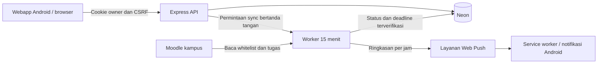

# NEXUS — Pengingat Tugas Semester

PWA pribadi berbahasa Indonesia untuk memantau tugas Moodle ITM Nganjuk. Web/API dan worker polling berjalan terpisah; Android menggunakan instalasi dari browser dan Web Push. Akun aplikasi dibuat oleh operator, lalu NIM/password Moodle dihubungkan lewat Pengaturan.

Panduan pemasangan lengkap: [docs/DEPLOY_LIGHTSAIL.md](docs/DEPLOY_LIGHTSAIL.md).

Repository: [sindufha/clone](https://github.com/sindufha/clone). Clone di VPS dengan `git clone https://github.com/sindufha/clone.git`, lalu ikuti panduan pemasangan untuk konfigurasi dan HTTPS.

## Perilaku aplikasi

- Polling Moodle setiap 15 menit, termasuk ketika webapp ditutup.
- Hanya sembilan mata kuliah pada [whitelist semester](shared/currentSemester.ts). Kelas dengan kandidat ganda harus dipilih sebelum tugasnya dipantau.
- Status dan deadline dibaca dari kolom Moodle yang relevan. Data yang tidak dapat diverifikasi tidak menghasilkan pengingat.
- Satu ringkasan push per perangkat per jam, 07.00–22.00 WIB, mulai H-7 sampai tepat 15 hari lewat deadline.
- Submitted menghentikan pengingat setelah sync. Lebih dari 15 hari masuk arsip; pemeriksaan arsip dilakukan paling sering sehari sekali.
- “Sudah diwakili kelompok” menghentikan pengingat lokal dan dapat dipulihkan.
- Password dan cookie Moodle memakai AES-256-GCM, terikat pada akun. Kunci disimpan dalam environment server, terpisah dari database.
- Cookie login aplikasi HttpOnly; endpoint perubahan memeriksa Origin dan CSRF. Satu owner dapat menggunakan beberapa perangkat.
- Service worker hanya mencache aset aplikasi. API dan data pribadi selalu melalui jaringan.



## Pengembangan lokal

Memerlukan Node.js 24 dan PostgreSQL / Neon branch pengembangan. File `.env` yang sudah ada tidak diubah otomatis. Gunakan konfigurasi baru hanya pada checkout pengembangan atau pilih `DOTENV_CONFIG_PATH` tersendiri.

```powershell
npm ci --ignore-scripts
Copy-Item .env.example .env.development
$env:DOTENV_CONFIG_PATH='.env.development'
npm run config:keys
```

Masukkan dua URL database pengembangan dan tiga kunci hasil generate ke `.env.development`. `APP_URL=http://localhost:5173`. Lalu:

```powershell
npm run db:migrate
npm run owner:create
npm run dev
```

Buka `http://localhost:5173`. Tiga proses berjalan: Vite 5173, API 4000, worker 4001. Polling berjalan di worker, bukan pada timer browser. Service worker dinonaktifkan dalam Vite dev; instalasi dan Web Push diuji pada build PWA melalui HTTPS atau secure localhost.

```powershell
npm test
npm run typecheck
npm run build
```

Build menghasilkan `dist/` dan `dist-server/`. Setelah konfigurasi produksi dan database siap, `npm start` menjalankan web/API, dan `npm run start:worker` menjalankan worker. Pada VPS, gunakan Docker Compose agar kedua proses tetap berjalan.

Untuk melihat UI dengan data contoh tanpa menyentuh Neon/Moodle:

```powershell
npm run build
node --import tsx tests/preview.mjs
```

Buka `http://localhost:4173`, akun fixture `preview` / `preview-pass-123`. Data fixture hanya berada di PostgreSQL sementara dalam proses ini; tidak dipakai pada runtime produksi dan tidak mengirim push. Hentikan dengan Ctrl+C.

## Database dan data lama

`001_initial.sql` mempertahankan skema snapshot lama. `002_personal_pwa.sql` menambah akun pribadi, koneksi Moodle, pemetaan kelas, tugas terverifikasi, lease worker, subscription, dan riwayat push. Migrasi berjalan berurutan dan idempoten memakai koneksi direct.

Tabel demo lama berisi snapshot 10 kelas/16 tugas. Data itu tetap tersimpan dan tidak dipakai oleh API pribadi atau pengingat. Jangan menjalankan `db:reset` untuk memasang aplikasi pribadi; script tersebut dapat menghapus data demo. Direktori `frontend/`, `backend/`, `server/liveLms.ts`, `server/repository.ts`, dan scraper lama tetap ada untuk referensi, tetapi bukan jalur runtime PWA baru.

Hasil scrape `*-data.json`, file `.env`, dan konfigurasi lokal tidak diunggah ke GitHub. Pengujian whitelist menggunakan fixture sintetis di `tests/fixtures/semester-snapshot.json`. Script seed lama membutuhkan hasil scrape lokal; pemasangan PWA memakai migrasi dan `owner:create`, tanpa seed.

Branch Neon sementara `nexus-pwa-implementation` telah dipakai untuk uji migrasi dan dijadwalkan kedaluwarsa 6 Oktober 2026 02.00 UTC. Script `scripts/check-neon.ts` hanya mengizinkan hostname branch uji tersebut. Koneksi disimpan di `.env.test.local` yang diabaikan Git. URL produksi tidak diubah dan migrasi produksi dijalankan operator saat deployment.

## Struktur utama

| Lokasi | Fungsi |
| --- | --- |
| `src/components/` | Login, tugas, kelas, pengaturan dan kontrol PWA |
| `server/moodle.ts` | Login HTTP, cookie jar, discovery kelas dan parser tugas |
| `server/sync.ts`, `server/worker.ts` | Sinkronisasi, retry, lease dan jadwal |
| `server/store.ts` | Data owner, whitelist, arsip, dan perlindungan run lama |
| `server/push.ts`, `public/push-sw.js` | Web Push, deduplikasi, tampil/klik notifikasi |
| `shared/reminders.ts` | Aturan H-7, 15 hari, freshness dan WIB |
| `scripts/owner.ts`, `scripts/keys.ts` | Bootstrap akun dan kunci |
| `Dockerfile`, `compose.yaml`, `deploy/nginx.conf` | Build dan runtime Linux |
| `tests/` | Parser, policy, enkripsi, database/API/worker dan fixture browser |

Moodle asli, Web Push Android, container VPS, dan operasi 24 jam perlu diverifikasi setelah konfigurasi di server tujuan. Waktu tampil notifikasi dipengaruhi jaringan, layanan push, dan pengaturan Android.
